# Fuzzy traffic congestion detection: Python replication

Python code, figures and documentation for

> M. Amini, M. F. Hatwagner, G. Cs. Mikulai and L. T. Koczy, "An intelligent traffic congestion detection approach based on fuzzy inference system," *2021 IEEE 15th International Symposium on Applied Computational Intelligence and Informatics (SACI)*, 2021, pp. 97–104, doi: [10.1109/SACI51354.2021.9465637](https://doi.org/10.1109/SACI51354.2021.9465637).

The paper builds a Mamdani fuzzy inference system in MATLAB (Fuzzy Logic Toolbox R2020b). It estimates the level of congestion (LOC) of a freeway segment from its traffic flow, length and number of lanes. This repository rebuilds that system in plain Python (NumPy only), regenerates every figure, and checks the paper's numerical claims.

**How faithful is it?** The membership functions and 56 of the 75 rules are read directly from the paper, and the paper's worked example is reproduced: the same four rules fire and LOC = 279.6 against the published 281. Rules 31–49 are not printed in the paper, so they are reconstructed, and one rule (76) is added to close a coverage gap. Section 6 lists every inferred value and why. If the original MATLAB `.fis` file exists, [`load_fis`](fuzzy_congestion/fisfile.py) builds an exact replica instead.

| | |
|---|---|
| Inputs | Flow (1–2000 veh/h, 5 terms), Length (0.1–19 km, 5 terms), Lane (1–4, 3 terms) |
| Output | Level of congestion, LOC (1–1875, 7 terms) |
| Rules | 75 from the paper (+1 added), `IF Flow AND Length AND Lane THEN LOC` |
| Inference | Mamdani: AND = min, implication = min, aggregation = max, centroid on 101 points (MATLAB defaults) |
| Worked example | Flow 253, Length 5.16 km, 2 lanes → LOC 279.6, *congestion free* (paper: 281, *congestion free*) |

## Contents

* [Quick start](#quick-start) and [repository layout](#repository-layout)
* [1. Fuzzy sets and Mamdani inference](#1-fuzzy-sets-and-mamdani-inference-paper-section-iii): paper Section III, Eqs. 1–4, Figs. 1–2
* [2. Case study data](#2-case-study-data-paper-section-iv): Section IV, Fig. 3
* [3. The proposed model](#3-the-proposed-model-paper-section-iva): Section IV.A, Eqs. 5–7, Tables I–II, Figs. 4–5
* [4. Results](#4-results-paper-section-v): Section V, Figs. 6–7, checks of the paper's claims
* [5. Conclusions of the paper](#5-conclusions-of-the-paper-in-short)
* [6. Reconstruction notes](#6-reconstruction-notes): what is read from the paper, what is inferred, and inconsistencies found
* [7. Using the model on your own data](#7-using-the-model-on-your-own-data)
* [8. Citation](#8-citation)

## Quick start

```bash
cd Paper1
python3 -m venv .venv
source .venv/bin/activate
pip install -r requirements.txt

python -m fuzzy_congestion 253 5.16 2 --trace   # the paper's worked example
python scripts/reproduce_results.py             # all numbers quoted in this README
python scripts/make_figures.py                  # regenerate figures/*.png
pytest                                          # 19 tests
```

Output of the first command:

```text
LOC = 279.59  ->  Congestion free
  w = 0.420   8. If (Flow is V.L) and (Length is Short) and (Lane is Average) then (LOC is C.C.free) (1)
  w = 0.470   9. If (Flow is V.L) and (Length is Avg.) and (Lane is Average) then (LOC is C.C.free) (1)
  w = 0.420   23. If (Flow is LOW) and (Length is Short) and (Lane is Average) then (LOC is C.free) (1)
  w = 0.530   24. If (Flow is LOW) and (Length is Avg.) and (Lane is Average) then (LOC is C.free) (1)
```

From Python:

```python
from fuzzy_congestion import build_model, classify

fis = build_model()
loc = fis.evaluate([253, 5.16, 2])          # 279.59
level = classify(loc)                        # 'C.free'
locs = fis.evaluate([[253, 5.16, 2], [1900, 0.5, 1]])   # many segments at once
```

## Repository layout

```text
Paper1/
├── README.md                     this document
├── fuzzy_congestion/             the model (NumPy only)
│   ├── membership.py             triangular / trapezoidal MFs (Eqs. 5, 6)
│   ├── mamdani.py                Mamdani engine (Eqs. 3, 4, 7) and control surfaces
│   ├── model.py                  the paper's variables (Tables I, II) and 75 (+1) rules
│   ├── fisfile.py                read / write MATLAB .fis files
│   ├── plots.py                  membership, rule-viewer and surface plots (matplotlib)
│   └── __main__.py               command line: python -m fuzzy_congestion
├── model/
│   └── traffic_congestion_reconstructed.fis   the reconstructed model, opens in MATLAB
├── scripts/
│   ├── make_figures.py           regenerates figures/*.png
│   ├── reproduce_results.py      worked example, surface ranges, checks of Section V claims
│   └── extract_paper_figures.py  copies the paper's figures to figures/original/ (needs PyMuPDF)
├── figures/                      figures generated by Python
│   └── original/                 figures as published in the paper
├── results/                      Fig. 7 surface grids as CSV
├── tests/test_model.py
├── requirements.txt
└── CITATION.cff
```

How the paper maps to the code:

| Paper | Code |
|---|---|
| Eqs. 1–2, fuzzy sets | [`MembershipFunction`](fuzzy_congestion/membership.py), [`Variable.fuzzify`](fuzzy_congestion/mamdani.py) |
| Eq. 3, if-then rule | [`Rule`](fuzzy_congestion/mamdani.py) |
| Eq. 4, max–min composition | [`MamdaniFIS.firing_strengths`, `MamdaniFIS.evaluate`](fuzzy_congestion/mamdani.py) |
| Eqs. 5 and 6, triangular and trapezoidal MFs | [`trimf`, `trapmf`](fuzzy_congestion/membership.py) |
| Eq. 7, centre of area | [`MamdaniFIS._centroid`](fuzzy_congestion/mamdani.py) |
| Tables I and II | [`FLOW`, `LENGTH`, `LANE`, `LOC`](fuzzy_congestion/model.py) |
| 75 rules (Fig. 5) | [`_RULE_TABLE`](fuzzy_congestion/model.py) |
| Fig. 6, rule viewer | [`plot_rule_viewer`](fuzzy_congestion/plots.py) |
| Fig. 7, control surfaces | [`MamdaniFIS.surface`](fuzzy_congestion/mamdani.py), [`plot_surface`](fuzzy_congestion/plots.py) |

---

## 1. Fuzzy sets and Mamdani inference (paper Section III)

### Eq. 1: crisp (binary) set

$$
\mu_A(x) = \begin{cases} 1, & x \in A \\ 0, & x \notin A \end{cases}
$$

In classical set theory an element either belongs to a set or does not. Applied to traffic, a rule such as "a segment is congested if flow > 1400 veh/h" treats 1399 and 1401 veh/h as entirely different states. The paper's argument is that traffic states have no sharp boundaries, so a binary classification is a poor basis for modelling them.

### Eq. 2: fuzzy set

$$
A = \{\, (x, \mu_A(x)) \mid x \in U \,\}, \qquad \mu_A : U \to [0, 1]
$$

A fuzzy set pairs every element $x$ of the universe $U$ with a membership degree $\mu_A(x)$ between 0 (not a member) and 1 (full member). A flow of 253 veh/h, for example, is "very low" to degree 0.47 and "low" to degree 0.53 at the same time. Each linguistic term of the model ("Very low", "Short", "Narrow", "Congestion free" and so on) is a fuzzy set of this kind.

### Fig. 1: architecture of a fuzzy inference system

<table>
<tr><th>Paper</th><th>Python</th></tr>
<tr>
<td>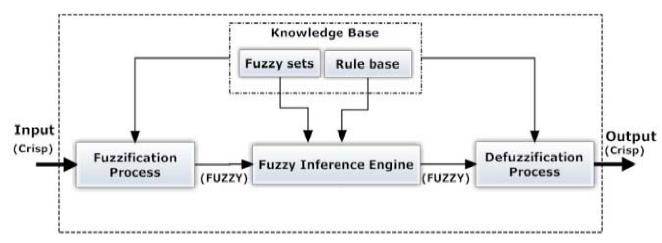</td>
<td>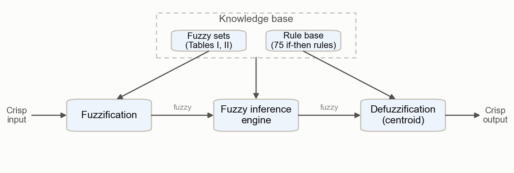</td>
</tr>
</table>

The system has four parts:

1. **Fuzzification** turns crisp inputs into membership degrees.
2. The **knowledge base** holds the fuzzy sets (Tables I and II) and the rule base (75 rules).
3. The **inference engine** combines the rules (Eqs. 3–4).
4. **Defuzzification** turns the resulting fuzzy set back into one number (Eq. 7).

### Eq. 3: Mamdani if-then rule

$$
\text{IF } x_1 \text{ is } A_{i1} \text{ AND } x_2 \text{ is } A_{i2} \text{ AND } \dots \text{ AND } x_r \text{ is } A_{ir} \text{ THEN } y \text{ is } B_i, \qquad i = 1, \dots, k
$$

Here $x_1 \dots x_r$ are the inputs, $y$ is the output, $A_{ij}$ and $B_i$ are linguistic terms, and $k$ is the number of rules. In this model $r = 3$ and $k = 75$, and every rule has the form

$$
\text{IF Flow is } F_i \text{ AND Length is } L_i \text{ AND Lane is } N_i \text{ THEN LOC is } C_i .
$$

### Eq. 4: max–min composition

As printed in the paper:

$$
\mu_{C_K}(z) = \max\big[\min[\mu_{A_K}(\text{input}(x)),\ \mu_{B_K}(\text{input}(y))]\big], \qquad K = 1, 2, \dots, r
$$

Written out step by step, which is what the code computes for a crisp input $(x_0, y_0)$:

$$
\begin{aligned}
w_k &= \min\big(\mu_{A_k}(x_0),\ \mu_{B_k}(y_0)\big) && \text{firing strength of rule } k \text{ (AND = min)}\\
\mu'_{C_k}(z) &= \min\big(w_k,\ \mu_{C_k}(z)\big) && \text{implication: the consequent is clipped at } w_k\\
\mu_C(z) &= \max_k\ \mu'_{C_k}(z) && \text{aggregation: union (max) of all clipped consequents}
\end{aligned}
$$

With three inputs the firing strength is $w_k = \min\big(\mu_{F_k}(\text{flow}),\ \mu_{L_k}(\text{length}),\ \mu_{N_k}(\text{lane})\big)$.

### Fig. 2: a two-rule max–min composition

<table>
<tr><th>Paper</th><th>Python (computed with the same engine)</th></tr>
<tr>
<td>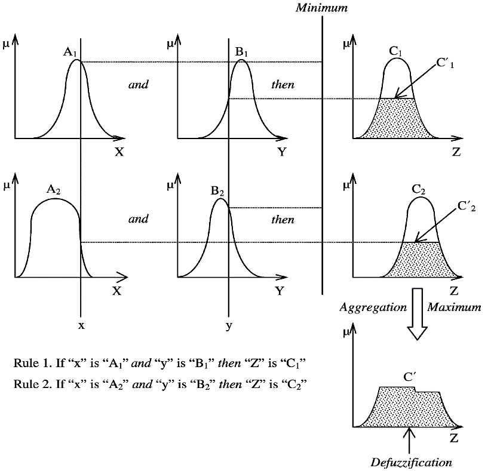</td>
<td>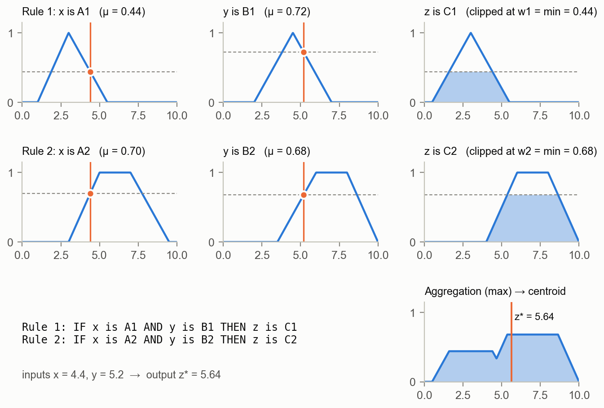</td>
</tr>
</table>

Each rule takes the smaller of its two input memberships (min), clips its output set at that height, and the clipped sets are joined (max). The centroid of the union is the crisp output. In the Python example, rule 1 fires at 0.44 and rule 2 at 0.68, and the centroid is $z^* = 5.64$.

---

## 2. Case study data (paper Section IV)

The model was designed on one week of data from the online transaction-processing server of the Hungarian UD e-toll system operated by NÚSZ. The data cover 212 freeways (links) split into 2446 segments. Seven variables were recorded: freeway name, section name, e-tolls sold per section (used as the number of vehicles), time (per minute), day, segment length (100–18 000 m) and number of lanes (2–4).

**The dataset is not part of this repository.** The model itself needs no data to run: its membership functions and rules encode what was learned from the data, the percentile distribution and expert judgement. To apply it to your own segments, see [Section 7](#7-using-the-model-on-your-own-data).

### Fig. 3: the freeway network

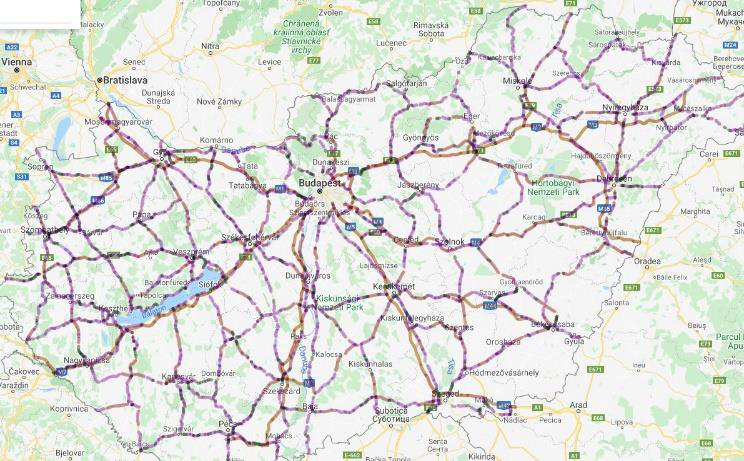

Fig. 3 is a map image (source cited in the paper as GSMPRO Kft. [41]), not model output, so it is shown as published and not regenerated.

---

## 3. The proposed model (paper Section IV.A)

### Fig. 4: the inference system

<table>
<tr><th>Paper (MATLAB Fuzzy Logic Designer)</th><th>Python</th></tr>
<tr>
<td>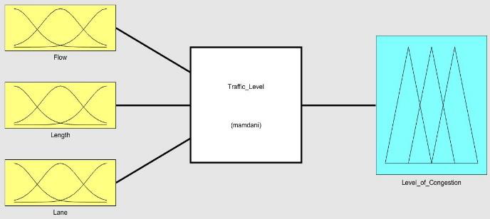</td>
<td>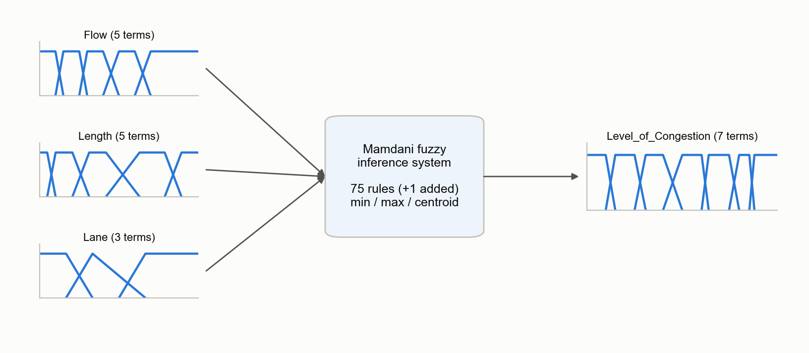</td>
</tr>
</table>

The paper designs the model in four steps.

### Step 1: linguistic variables and ranges (Tables I and II)

**Table I, input variables** (as published):

| Input | Numerical range | Linguistic term | Impact on congestion |
|---|---|---|---|
| Flow | 1 < F ≤ 300 veh | Very low | Very small impact |
| | 200 ≤ F ≤ 600 | Low | Small impact |
| | 500 ≤ F ≤ 1000 | Average | Steady state |
| | 800 ≤ F ≤ 1400 | High | High increasing impact |
| | 1200 ≤ F < 2000 | Very high | Very high increasing impact |
| Length (km) | 0.1 < Le ≤ 2 | Very short | Very high impact |
| | 1 ≤ Le ≤ 6 | Short | High impact |
| | 4 ≤ Le ≤ 12 | Average | Steady state |
| | 8 ≤ Le ≤ 17 | Long | Reducing impact |
| | 15 ≤ Le < 19 | Very long | High reducing impact |
| Lane | 1 < La ≤ 2 | Narrow | High increasing impact |
| | 2 ≤ La ≤ 3 | Average | Reducing impact |
| | 3 ≤ La < 4 | Wide | High reducing impact |

**Table II, output variable** (as published; "Equivalence" lists the input conditions that lead to each level):

| Range (veh) | Level of congestion | Equivalence |
|---|---|---|
| 1 < LOC ≤ 280 | Completely congestion free | Flow very low/low/avg. AND lane narrow/avg./wide AND length short/avg./long/very long |
| 186 ≤ LOC ≤ 580 | Congestion free | Flow very low/low/avg./high AND lane narrow/avg./wide AND length avg./long/very long |
| 470 ≤ LOC ≤ 940 | Low | Flow low/avg./high/very high AND lane narrow/avg./wide AND length avg./long/very long |
| 750 ≤ LOC ≤ 1200 | Stable | Flow low/avg./high/very high AND lane narrow/avg./wide AND length short/avg./long/very long |
| 1130 ≤ LOC ≤ 1500 | Near congestion | Flow avg./high/very high AND lane narrow/avg./wide AND length short/avg. |
| 1400 ≤ LOC ≤ 1650 | Congestion | Flow high/very high AND lane narrow/avg. AND length very short/short/avg. |
| 1600 ≤ LOC < 2000 | Severe congestion | Flow very high AND lane narrow/avg. AND length very short/short |

### Step 2: fuzzification with triangular and trapezoidal membership functions (Eqs. 5 and 6)

**Eq. 5, triangular MF** with feet $\alpha_{min}$, $\alpha_{max}$ and peak $\beta$:

$$
\mu_\Lambda(x) = \begin{cases}
0, & x < \alpha_{min} \\
\dfrac{x - \alpha_{min}}{\beta - \alpha_{min}}, & x \in (\alpha_{min}, \beta) \\
\dfrac{\alpha_{max} - x}{\alpha_{max} - \beta}, & x \in (\beta, \alpha_{max}) \\
0, & x > \alpha_{max}
\end{cases}
$$

Membership rises linearly from 0 at $\alpha_{min}$ to 1 at $\beta$, then falls back to 0 at $\alpha_{max}$.

**Eq. 6, trapezoidal MF** with feet $\alpha_{min}$, $\alpha_{max}$ and shoulders $\beta_1 \le \beta_2$:

$$
\mu_\Lambda(x) = \begin{cases}
0, & x \le \alpha_{min} \\
\dfrac{x - \alpha_{min}}{\beta_1 - \alpha_{min}}, & x \in (\alpha_{min}, \beta_1) \\
1, & x \in [\beta_1, \beta_2] \\
\dfrac{\alpha_{max} - x}{\alpha_{max} - \beta_2}, & x \in (\beta_2, \alpha_{max}) \\
0, & x \ge \alpha_{max}
\end{cases}
$$

Between the shoulders membership is 1; the printed equation in the paper leaves this middle case implicit. With $\alpha_{min} = \beta_1$ (or $\beta_2 = \alpha_{max}$) the trapezoid becomes a left (or right) "shoulder", which the model uses for the outermost terms such as "Very low" and "Very high". The code follows MATLAB's `trimf` and `trapmf` exactly, including these degenerate cases.

**Parameters used.** Table I/II give each term's support; full membership starts and ends where the neighbouring terms' ranges end. For example, "Low" flow covers 200–600, "Very low" ends at 300 and "Average" starts at 500, so Low = trap(200, 300, 500, 600). The lane terms were measured from Fig. 6 (see [Section 6](#6-reconstruction-notes)).

| Variable | Term | MATLAB label | Membership function |
|---|---|---|---|
| Flow | Very low | `V.L` | trapmf(1, 1, 200, 300) |
| Flow | Low | `LOW` | trapmf(200, 300, 500, 600) |
| Flow | Average | `Avg.` | trapmf(500, 600, 800, 1000) |
| Flow | High | `High` | trapmf(800, 1000, 1200, 1400) |
| Flow | Very high | `V.High` | trapmf(1200, 1400, 2000, 2000) |
| Length | Very short | `V.Short` | trapmf(0.1, 0.1, 1, 2) |
| Length | Short | `Short` | trapmf(1, 2, 4, 6) |
| Length | Average | `Avg.` | trapmf(4, 6, 8, 12) |
| Length | Long | `Long` | trapmf(8, 12, 15, 17) |
| Length | Very long | `V.Long` | trapmf(15, 17, 19, 19) |
| Lane | Narrow | `Narrow` | trapmf(1, 1, 1.5, 2) |
| Lane | Average | `Average` | trimf(1.5, 2, 3) |
| Lane | Wide | `Wide` | trapmf(2.5, 3, 4, 4) |
| LOC | Completely congestion free | `C.C.free` | trapmf(1, 1, 186, 280) |
| LOC | Congestion free | `C.free` | trapmf(186, 280, 470, 580) |
| LOC | Low | `Low` | trapmf(470, 580, 750, 940) |
| LOC | Stable | `Stable` | trapmf(750, 940, 1130, 1200) |
| LOC | Near congestion | `Near_C.` | trapmf(1130, 1200, 1400, 1500) |
| LOC | Congestion | `C.` | trapmf(1400, 1500, 1600, 1650) |
| LOC | Severe congestion | `Severe_C.` | trapmf(1600, 1650, 2000, 2000) |

Universes (paper Section V): Flow 1–2000 veh per 60 min, Length 0.1–19 km, Lane 1–4, LOC 1–1875.

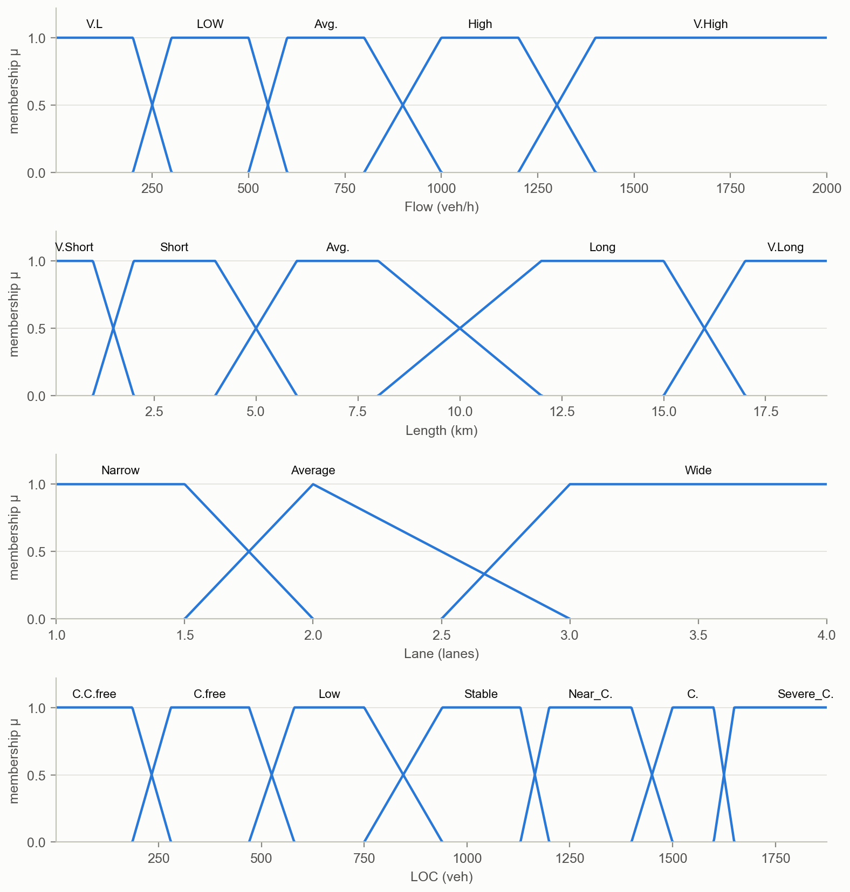

### Step 3: the rule base (Fig. 5)

The paper defines 75 rules, one per combination of 5 flow × 5 length × 3 lane terms, "based on the available dataset, percentile distribution of the data, and experts' judgement". Fig. 5 shows rules 50–75 in MATLAB's rule editor. The matrix on the right shows all of them: each cell gives the consequent and the rule number, and darker cells mean more congestion.

<table>
<tr><th>Paper (rules 50–75)</th><th>Python: the complete rule base</th></tr>
<tr>
<td>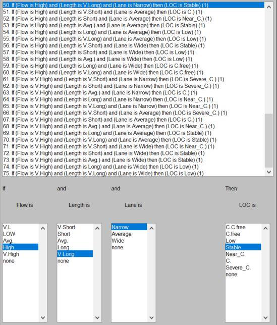</td>
<td>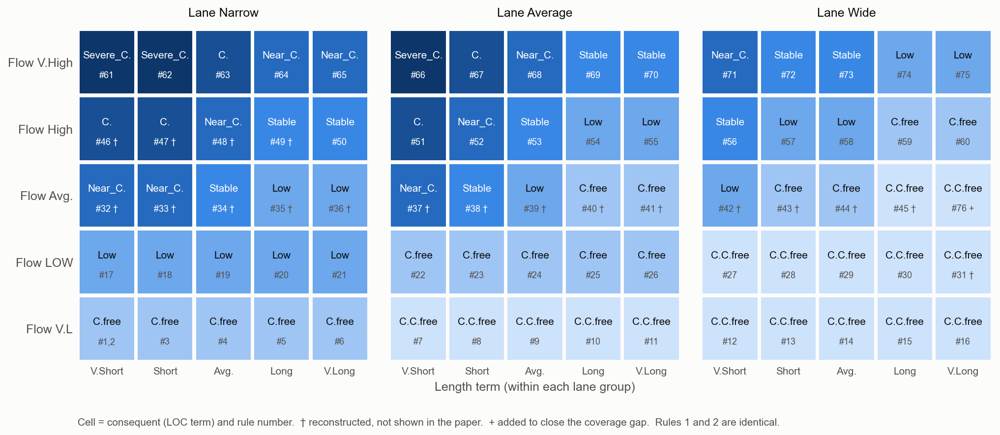</td>
</tr>
</table>

The pattern is easy to read from the matrix. LOC rises with flow, falls with length (more length means more capacity to absorb demand), and falls with the number of lanes. For very low and low flow the length does not matter; from average flow upward it does.

<details>
<summary><b>All rules as a table</b> (click to expand)</summary>

| # | Flow | Length | Lane | → LOC | Source |
|---:|---|---|---|---|---|
| 1 | V.L | V.Short | Narrow | C.free | Fig. 6 |
| 2 | V.L | V.Short | Narrow | C.free | Fig. 6 |
| 3 | V.L | Short | Narrow | C.free | Fig. 6 |
| 4 | V.L | Avg. | Narrow | C.free | Fig. 6 |
| 5 | V.L | Long | Narrow | C.free | Fig. 6 |
| 6 | V.L | V.Long | Narrow | C.free | Fig. 6 |
| 7 | V.L | V.Short | Average | C.C.free | Fig. 6 |
| 8 | V.L | Short | Average | C.C.free | Fig. 6 |
| 9 | V.L | Avg. | Average | C.C.free | Fig. 6 |
| 10 | V.L | Long | Average | C.C.free | Fig. 6 |
| 11 | V.L | V.Long | Average | C.C.free | Fig. 6 |
| 12 | V.L | V.Short | Wide | C.C.free | Fig. 6 |
| 13 | V.L | Short | Wide | C.C.free | Fig. 6 |
| 14 | V.L | Avg. | Wide | C.C.free | Fig. 6 |
| 15 | V.L | Long | Wide | C.C.free | Fig. 6 |
| 16 | V.L | V.Long | Wide | C.C.free | Fig. 6 |
| 17 | LOW | V.Short | Narrow | Low | Fig. 6 |
| 18 | LOW | Short | Narrow | Low | Fig. 6 |
| 19 | LOW | Avg. | Narrow | Low | Fig. 6 |
| 20 | LOW | Long | Narrow | Low | Fig. 6 |
| 21 | LOW | V.Long | Narrow | Low | Fig. 6 |
| 22 | LOW | V.Short | Average | C.free | Fig. 6 |
| 23 | LOW | Short | Average | C.free | Fig. 6 |
| 24 | LOW | Avg. | Average | C.free | Fig. 6 |
| 25 | LOW | Long | Average | C.free | Fig. 6 |
| 26 | LOW | V.Long | Average | C.free | Fig. 6 |
| 27 | LOW | V.Short | Wide | C.C.free | Fig. 6 |
| 28 | LOW | Short | Wide | C.C.free | Fig. 6 |
| 29 | LOW | Avg. | Wide | C.C.free | Fig. 6 |
| 30 | LOW | Long | Wide | C.C.free | Fig. 6 |
| 31 | LOW | V.Long | Wide | C.C.free | **reconstructed** |
| 32 | Avg. | V.Short | Narrow | Near_C. | **reconstructed** |
| 33 | Avg. | Short | Narrow | Near_C. | **reconstructed** |
| 34 | Avg. | Avg. | Narrow | Stable | **reconstructed** |
| 35 | Avg. | Long | Narrow | Low | **reconstructed** |
| 36 | Avg. | V.Long | Narrow | Low | **reconstructed** |
| 37 | Avg. | V.Short | Average | Near_C. | **reconstructed** |
| 38 | Avg. | Short | Average | Stable | **reconstructed** |
| 39 | Avg. | Avg. | Average | Low | **reconstructed** |
| 40 | Avg. | Long | Average | C.free | **reconstructed** |
| 41 | Avg. | V.Long | Average | C.free | **reconstructed** |
| 42 | Avg. | V.Short | Wide | Low | **reconstructed** |
| 43 | Avg. | Short | Wide | C.free | **reconstructed** |
| 44 | Avg. | Avg. | Wide | C.free | **reconstructed** |
| 45 | Avg. | Long | Wide | C.C.free | **reconstructed** |
| 46 | High | V.Short | Narrow | C. | **reconstructed** |
| 47 | High | Short | Narrow | C. | **reconstructed** |
| 48 | High | Avg. | Narrow | Near_C. | **reconstructed** |
| 49 | High | Long | Narrow | Stable | **reconstructed** |
| 50 | High | V.Long | Narrow | Stable | Fig. 5 |
| 51 | High | V.Short | Average | C. | Fig. 5 |
| 52 | High | Short | Average | Near_C. | Fig. 5 |
| 53 | High | Avg. | Average | Stable | Fig. 5 |
| 54 | High | Long | Average | Low | Fig. 5 |
| 55 | High | V.Long | Average | Low | Fig. 5 |
| 56 | High | V.Short | Wide | Stable | Fig. 5 |
| 57 | High | Short | Wide | Low | Fig. 5 |
| 58 | High | Avg. | Wide | Low | Fig. 5 |
| 59 | High | Long | Wide | C.free | Fig. 5 |
| 60 | High | V.Long | Wide | C.free | Fig. 5 |
| 61 | V.High | V.Short | Narrow | Severe_C. | Fig. 5 |
| 62 | V.High | Short | Narrow | Severe_C. | Fig. 5 |
| 63 | V.High | Avg. | Narrow | C. | Fig. 5 |
| 64 | V.High | Long | Narrow | Near_C. | Fig. 5 |
| 65 | V.High | V.Long | Narrow | Near_C. | Fig. 5 |
| 66 | V.High | V.Short | Average | Severe_C. | Fig. 5 |
| 67 | V.High | Short | Average | C. | Fig. 5 |
| 68 | V.High | Avg. | Average | Near_C. | Fig. 5 |
| 69 | V.High | Long | Average | Stable | Fig. 5 |
| 70 | V.High | V.Long | Average | Stable | Fig. 5 |
| 71 | V.High | V.Short | Wide | Near_C. | Fig. 5 |
| 72 | V.High | Short | Wide | Stable | Fig. 5 |
| 73 | V.High | Avg. | Wide | Stable | Fig. 5 |
| 74 | V.High | Long | Wide | Low | Fig. 5 |
| 75 | V.High | V.Long | Wide | Low | Fig. 5 |
| 76 | Avg. | V.Long | Wide | C.C.free | **added** |

</details>

### Step 4: defuzzification by centre of area (Eq. 7)

$$
z_{COA} = \frac{\int_Z \mu_A(z)\, z \, dz}{\int_Z \mu_A(z)\, dz}
$$

$\mu_A(z)$ is the aggregated output set from Eq. 4, and $z_{COA}$ is the abscissa of its centre of gravity, the balance point of the shape. Like MATLAB, the code evaluates the integral as a sum over 101 evenly spaced points $z_j$ of the output range $[1, 1875]$:

$$
z^* = \frac{\sum_{j=0}^{100} \mu_A(z_j)\, z_j}{\sum_{j=0}^{100} \mu_A(z_j)}, \qquad z_j = 1 + j \cdot \frac{1874}{100}
$$

The discretisation matters slightly. For the worked example below the 101-point sum gives 279.6, while the exact integral gives 284.2. Use `build_model(n_points=...)` to change it. If no rule fires at all, MATLAB returns the middle of the output range (938), and so does this code.

---

## 4. Results (paper Section V)

### Fig. 6: the worked example (Flow = 253, Length = 5.16 km, Lane = 2)

<table>
<tr><th>Paper (MATLAB rule viewer, rules 1–30)</th></tr>
<tr><td>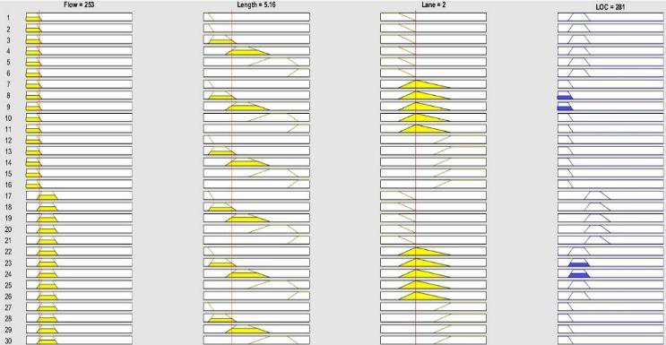</td></tr>
<tr><th>Python (same layout, rules 1–30 and the aggregated output)</th></tr>
<tr><td>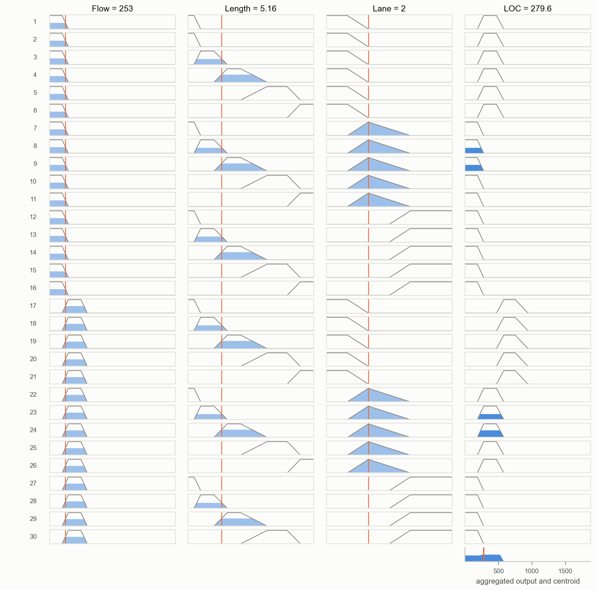</td></tr>
</table>

Each row is one rule. The input columns show how strongly that rule's antecedent matches the input (orange line), and the last column shows the consequent clipped at the rule's firing strength. In both versions exactly rules 8, 9, 23 and 24 fire.

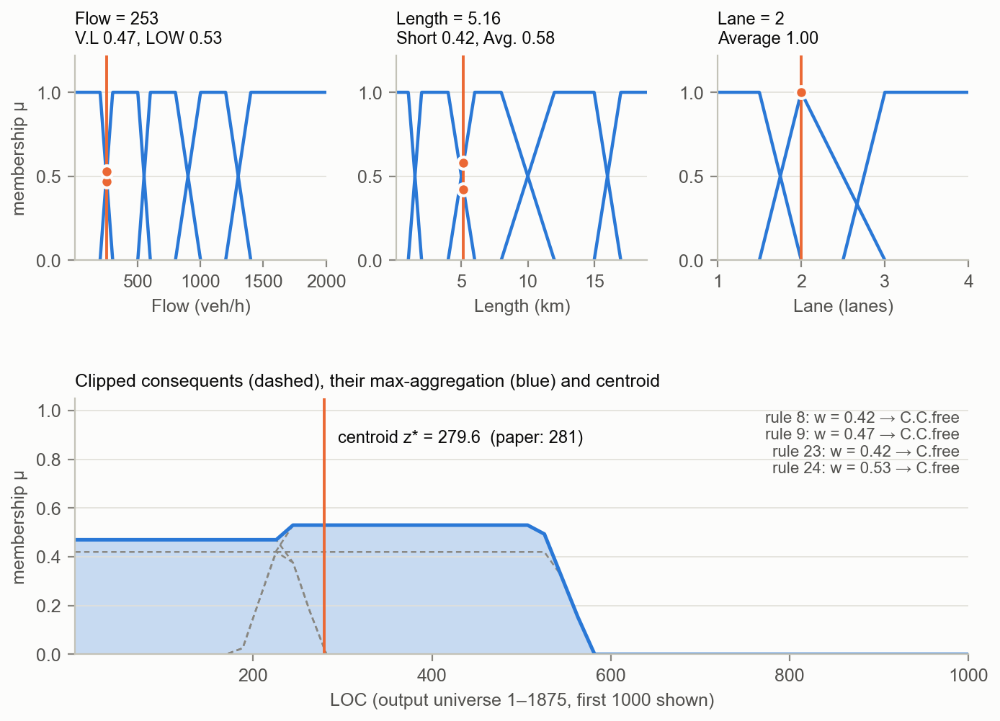

Step by step:

| Step | Computation | Result |
|---|---|---|
| Fuzzify Flow = 253 | μ<sub>V.L</sub> = (300 − 253)/(300 − 200); μ<sub>LOW</sub> = (253 − 200)/(300 − 200) | 0.47; 0.53 |
| Fuzzify Length = 5.16 | μ<sub>Short</sub> = (6 − 5.16)/(6 − 4); μ<sub>Avg.</sub> = (5.16 − 4)/(6 − 4) | 0.42; 0.58 |
| Fuzzify Lane = 2 | peak of "Average"; "Narrow" and "Wide" are 0 at 2 | 1.00 |
| Rule 8 (V.L, Short, Average → C.C.free) | min(0.47, 0.42, 1) | 0.42 |
| Rule 9 (V.L, Avg., Average → C.C.free) | min(0.47, 0.58, 1) | 0.47 |
| Rule 23 (LOW, Short, Average → C.free) | min(0.53, 0.42, 1) | 0.42 |
| Rule 24 (LOW, Avg., Average → C.free) | min(0.53, 0.58, 1) | 0.53 |
| Aggregate (max) | C.C.free clipped at max(0.42, 0.47); C.free clipped at max(0.42, 0.53) | 0.47; 0.53 |
| Defuzzify (Eq. 7, 101 points) | centre of area | **279.6** |
| Classify | μ<sub>C.free</sub>(279.6) = 0.996 > μ<sub>C.C.free</sub>(279.6) = 0.004 | **Congestion free** |

The paper reports LOC = 281, *congestion free*. MATLAB's rule viewer displays rounded inputs, and Flow = 253.7 (shown as "253") gives 281.3, so the two results agree within display rounding.

### Fig. 7: control surfaces

A control surface shows the output over a grid of two inputs, with the third input held fixed. Like MATLAB's `gensurf`, the code uses a 15 × 15 grid and holds the third input at the middle of its range: Flow = 1000.5, Length = 9.55 km, Lane = 2.5. The Python plots use the same camera angles as the paper. Colour encodes LOC on one fixed scale (light = free flow, dark = severe), so equal shades mean equal LOC in all three panels.

<table>
<tr><th>Paper</th><th>Python</th></tr>
<tr>
<td>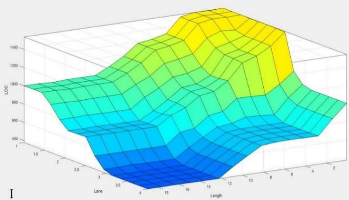</td>
<td>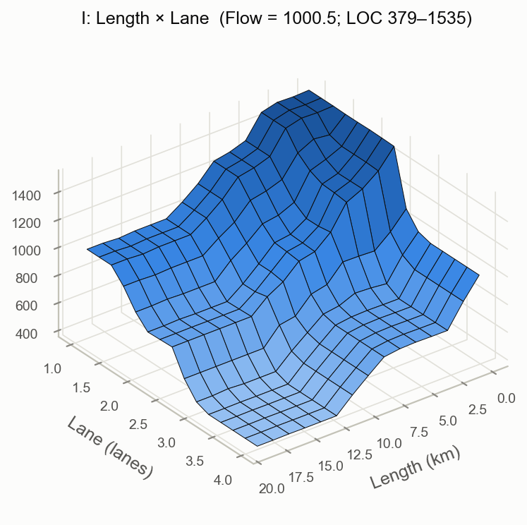</td>
</tr>
<tr><td colspan="2"><b>I: Length × Lane</b> (Flow = 1000.5). At this flow only "High" fires (μ<sub>High</sub> = 1), so the surface comes entirely from rules 46–60.</td></tr>
<tr>
<td>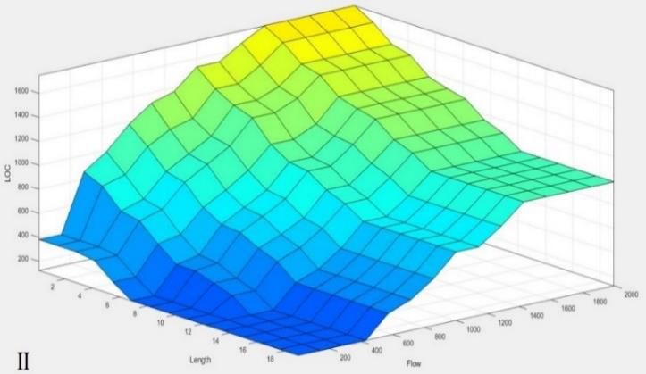</td>
<td>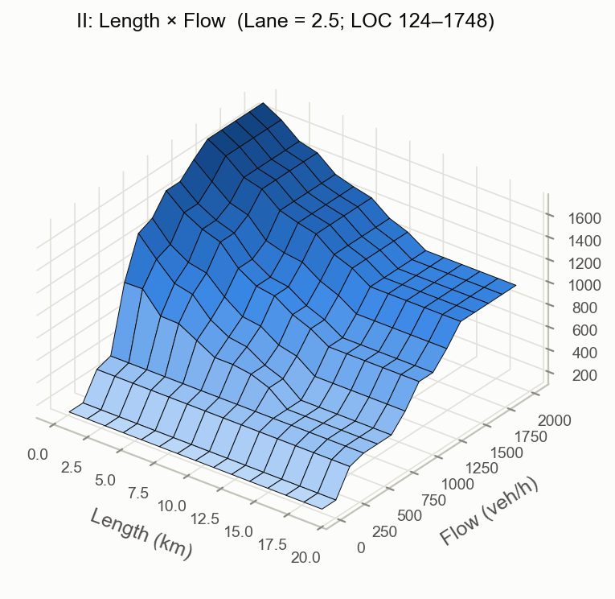</td>
</tr>
<tr><td colspan="2"><b>II: Length × Flow</b> (Lane = 2.5). At 2.5 lanes only "Average" lane fires, at 0.5.</td></tr>
<tr>
<td>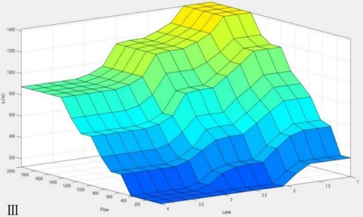</td>
<td>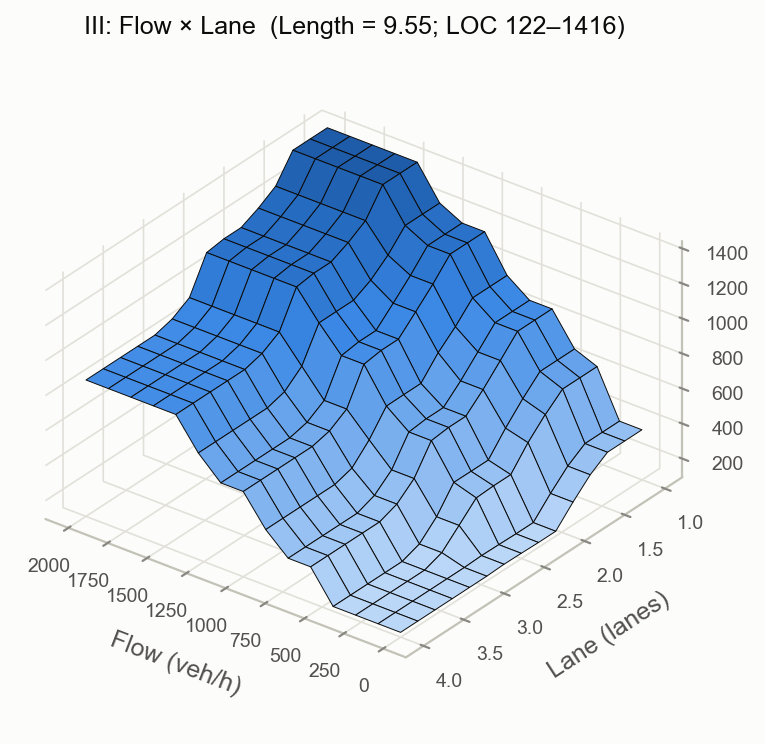</td>
</tr>
<tr><td colspan="2"><b>III: Flow × Lane</b> (Length = 9.55 km). μ<sub>Avg.</sub> = 0.61, μ<sub>Long</sub> = 0.39.</td></tr>
</table>

| Surface | Python LOC range | Paper LOC range (read off the axes) |
|---|---|---|
| I | 379–1535 | ≈ 400–1500 |
| II | 124–1748 | ≈ 150–1700 |
| III | 122–1416 | ≈ 150–1450 |

All three surfaces have the shape and range of the published ones. Surface I is the closest match; it depends only on the High-flow rules, most of which are printed in Fig. 5. Surfaces II and III differ at low flow. In the paper's Fig. 7-II, LOC changes between Flow = 1 and Flow ≈ 143 veh/h, but with the flow membership functions shown in Fig. 6 both values are fully "Very low" and must give the same LOC. So Figs. 7-II and 7-III were most likely produced from a slightly different version of the model than Figs. 5 and 6. This replication follows Figs. 5 and 6, which show the actual rules and membership functions. The surface data are in [results/](results/).

### Checking the claims of Section V

`python scripts/reproduce_results.py` computes the following.

| Claim in the paper | This model | Verdict |
|---|---|---|
| Fig. 7-I: "the most severe alteration takes place in the LOC when length is approximately in the range of 4–6 km and lane is 2–3" | Change in LOC across each length transition (Flow = 1000.5). Lane 2.5: 1–2 km −219, **4–6 km −322**, 8–12 km −293. Lane 2: 4–6 km −307, 8–12 km −313. Lane 3: 4–6 km 0. | Partly: the largest step at 2.5 lanes, about equal to the 8–12 km step at 2 lanes, absent at 3 lanes |
| Fig. 7-II: for lengths of about 1–6 km, increasing flow beyond 200 gives an "intensive reaction (around 50% increase)" | +200 veh/h raises LOC by a median 11%; ≥ 50% in 15% of cases; at most +244% (low → average flow on very short segments) | Partly: 50% and more occurs, but only in parts of the range |
| Fig. 7-III: "Segments with 3 and 4 lanes will not experience severe congestion at all" | Highest LOC anywhere with 3–4 lanes = 1308 (*near congestion*) | Reproduced |
| Fig. 7-III: "increasing flow rate by 200 vehicles in less than 2 lanes segments can increase LOC by more than 50%" | Up to +212%; ≥ 50% in 10% of cases | Reproduced |

The first, second and fourth claims depend partly on reconstructed rules 32–49, so they test the reconstruction as much as the paper.

---

## 5. Conclusions of the paper, in short

The paper concludes that a Mamdani fuzzy system built from a few readily available segment properties detects the severity of congestion with low computational effort and with tolerance to noisy, imprecise data. It suggests this as a basis for traffic-breakdown alerts and early-warning systems. It names two limitations: all inputs are weighted equally, and the model rests on one week of data.

---

## 6. Reconstruction notes

Everything below documents how the Python model was derived from the published paper, and where the paper's figures, tables and text disagree. The last part may be useful for a revised or extended version.

### Membership functions

* **Supports** are the "Numerical Ranges" of Tables I and II. **Shoulders** (where membership reaches 1) are where the neighbouring ranges end. Every resulting breakpoint was checked against pixel positions in the rule viewer (Fig. 6). For example, the "Low" LOC trapezoid's corners measure 469 / 573 / 747 / 922 against the model's 470 / 580 / 750 / 940.
* **Lane.** Table I gives non-overlapping lane ranges, but Fig. 6 shows overlapping shapes. Measured from Fig. 6: Narrow falls from 1.5 to 0 at 2.0, Average is a triangle peaking at 2.0 with feet at 1.5 and 3.0, and Wide rises from 2.5 to 1 at 3.0. A lane value of 2 is therefore fully "Average", which is why only Average-lane rules fire in the worked example.
* **LOC universe.** Section V gives 1–1875; Table II's last range goes to 2000. The positions in Fig. 6 fit 1–1875 better, and the model uses it. "Severe congestion" is trapmf(1600, 1650, 2000, 2000) and is evaluated only up to 1875.

### Rules

* **Rules 1–30** are read from the rule viewer (Fig. 6), which shows each rule's antecedent and consequent shapes. A script classified every row by the position of its shapes.
* **Rules 50–75** are transcribed from the rule editor (Fig. 5).
* **Rules 31–49 are not shown in the paper and are reconstructed.** In all ten visible High-flow rules with Average or Wide lanes (51–60), the consequent is exactly one level below the matching Very-high-flow rule, and rule 50 fits the same pattern. This "one level less per flow step" rule was used to fill:
  * rules 46–49 (High flow, Narrow): C., C., Near_C., Stable;
  * rules 32–45 (Average flow): one level below High flow, floored at C.C.free. This also matches Table II, which lists outcomes from *completely congestion free* to *near congestion* for average flow. A length-independent alternative (like the Very-low and Low flow rules) was rejected because it cannot produce those two outcomes;
  * rule 31 (Low, V.Long, Wide): C.C.free, like rules 27–30.

  Fig. 7-I depends only on High-flow rules, and its match with the paper supports rules 46–49.
* **Rules 1 and 2 are identical** (Very low flow, Very short, Narrow → Congestion free). Fig. 6 shows the same shapes in both rows. Rule numbers 1–30 and 50–75 are fixed by the figures, so the 15 slots 31–45 must hold rule 31 and the Average-flow rules. That leaves room for only 14 of the 15 Average-flow combinations. **The paper's 75 rules therefore cover only 74 of the 75 input combinations.** Where no rule fires, MATLAB (and this code) returns the mid-range value 938, which is a large artefact (e.g. 938 instead of about 114 at Flow 700, Length 18 km, 3.5 lanes). Which combination was missing in the original is not knowable from the paper. The model adds (Average flow, V.Long, Wide → C.C.free) as **rule 76**; `build_model(PAPER_RULES)` gives the strict 75-rule version with the gap.

### Places where the paper disagrees with itself

* Section V says the example is classified by "membership function presented in table 4"; the paper has no Table 4, and the classification comes from Table II.
* LOC range: 1–1875 in Section V; up to 2000 in Table II.
* Lane: non-overlapping ranges in Table I, overlapping membership functions in Fig. 6.
* Table II's "Equivalence" column does not match the rules in Fig. 5 exactly. Examples:
  * Rule 56 (High, V.Short, Wide → Stable): Table II lists Stable only for short to very long segments.
  * Rule 57 (High, Short, Wide → Low): Table II lists Low only for average to very long segments.
  * Rule 64 (V.High, Long, Narrow → Near_C.): Table II lists Near congestion only for short and average segments.
  * Table II lists Stable for low flow, but rules 17–31 never give Stable.
* Figs. 7-II and 7-III do not match the membership functions in Fig. 6 at low flow (see [Fig. 7](#fig-7-control-surfaces)).
* The paper's Eq. 6 omits the middle case (μ = 1 between β₁ and β₂), and Eq. 4 omits the consequent membership function inside the max–min.

### Getting an exact replica

If the original MATLAB model file is available, every uncertainty above disappears:

```bash
python -m fuzzy_congestion 253 5.16 2 --fis path/to/original.fis
```

```python
from fuzzy_congestion.fisfile import load_fis
fis = load_fis("path/to/original.fis")       # exact rules and membership functions
```

In the other direction, [model/traffic_congestion_reconstructed.fis](model/traffic_congestion_reconstructed.fis) is this reconstruction as a MATLAB file. Open it with `readfis` or the Fuzzy Logic Designer to compare it with the original.

---

## 7. Using the model on your own data

Prepare a CSV with one row per segment and the columns `flow` (vehicles per hour), `length_km` and `lanes`:

```csv
flow,length_km,lanes
253,5.16,2
1900,0.5,1
700,18,3.5
```

```bash
python -m fuzzy_congestion --csv segments.csv --out segments_loc.csv
```

The output keeps your columns and adds `loc` and `level`:

```csv
flow,length_km,lanes,loc,level
253,5.16,2,279.59,Congestion free
1900,0.5,1,1753.90,Severe congestion
700,18,3.5,113.85,Completely congestion free
```

The command line clips inputs to the model's ranges (Flow 1–2000, Length 0.1–19 km, Lane 1–4) and prints a note when it does. Outside those ranges every membership function is 0, so no rule would fire and the output would fall back to 938. `fis.evaluate` in Python does not clip, to stay identical to MATLAB, so clip first (`numpy.clip`) when calling it directly.

---

## 8. Citation

```bibtex
@inproceedings{amini2021congestion,
  author    = {Amini, Mehran and Hatwagner, Miklos F. and Mikulai, Gergely Cs. and Koczy, Laszlo T.},
  title     = {An intelligent traffic congestion detection approach based on fuzzy inference system},
  booktitle = {2021 IEEE 15th International Symposium on Applied Computational Intelligence and Informatics (SACI)},
  pages     = {97--104},
  year      = {2021},
  doi       = {10.1109/SACI51354.2021.9465637}
}
```

The research was supported by the National Research, Development and Innovation Office (NKFIH), grant K124055.

**Before publishing this repository:** choose a licence for the code. The images in `figures/original/` and the paper PDF are copied from the published article (© IEEE); check IEEE's author reuse policy before making them public. Fig. 3's base map has its own terms. The PDF is listed in `.gitignore` for that reason.
